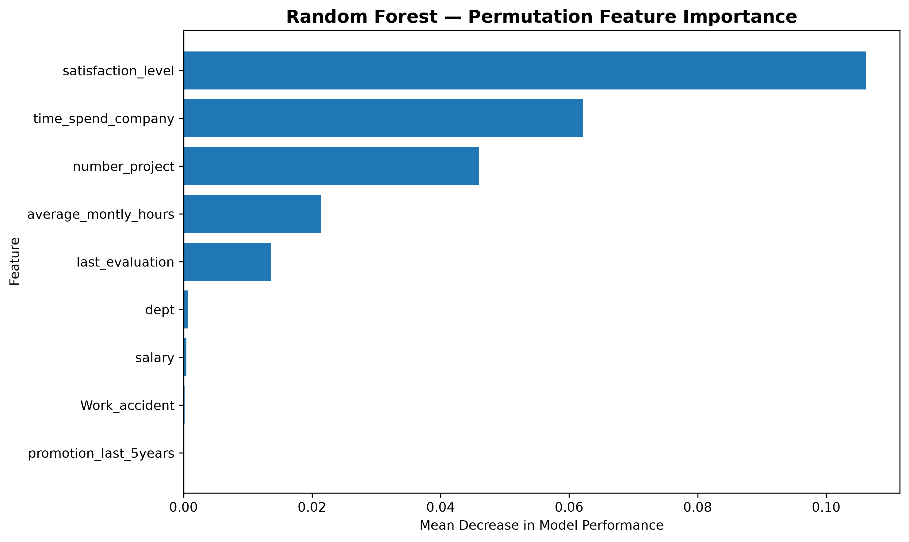
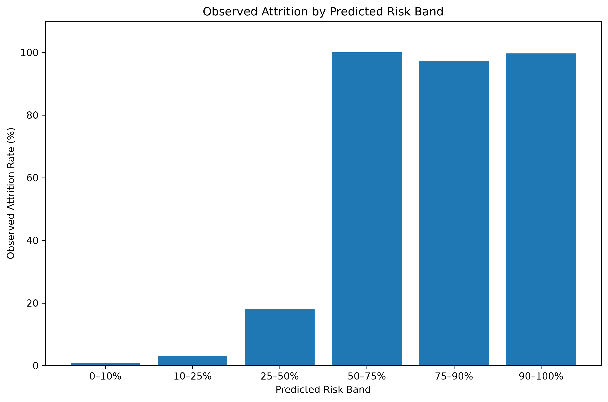
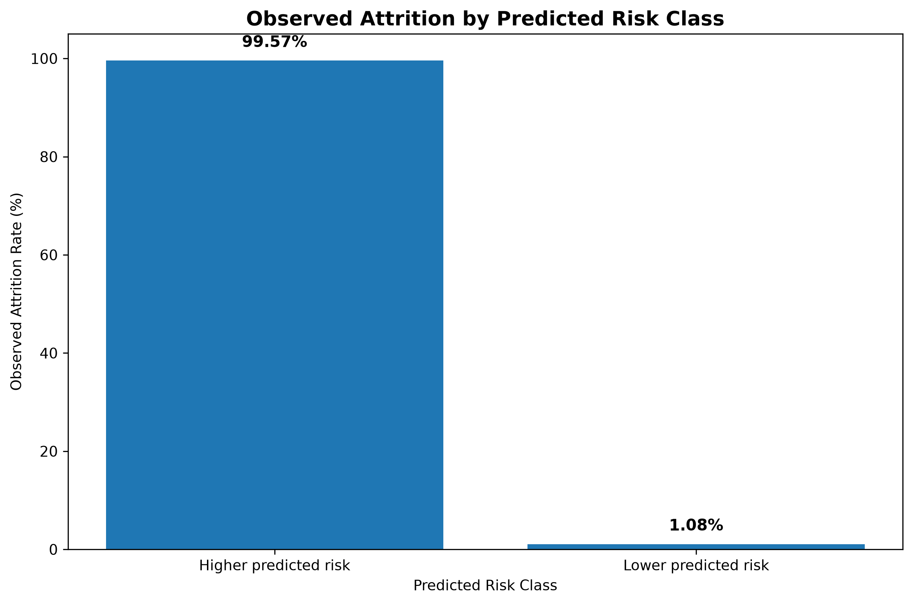
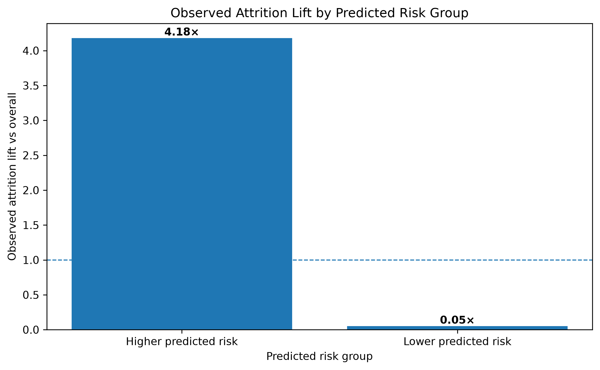

# Employee Attrition Analysis & Prediction

## Business Context

Company X is seeking to better understand employee attrition and identify employee characteristics and groups associated with higher rates of employee turnover.

The original business exercise provided historical records for existing employees and employees who had left the organisation. The available attributes include satisfaction, performance evaluation, number of projects, monthly working hours, tenure, work accidents, promotions, department, and salary.

This project rebuilds and extends that analysis using a more rigorous 2026 analytics workflow. The objective is not simply to describe historical attrition, but to combine **exploratory analysis, statistical testing, predictive modelling, and risk segmentation** to identify patterns that could support retention-focused decision-making.

> **Analytical note:** Model outputs represent estimated attrition risk based on historical characteristics. They are not certain predictions, causal conclusions, or recommendations to take action against individual employees.

---

## Objectives

The project addresses four main questions:

1. **What types of employees are associated with higher attrition rates?**
2. **Which employee characteristics show meaningful relationships with attrition?**
3. **Can historical employee characteristics be used to estimate attrition risk?**
4. **Can employees be grouped into interpretable risk segments that help prioritise retention analysis?**

---

## Dataset

The combined modelling dataset contains:

- **14,999 employee records**
- **10 employee attributes**
- **1 attrition outcome**

### Variables

| Variable | Description |
|---|---|
| `Emp ID` | Employee identifier |
| `satisfaction_level` | Employee satisfaction score |
| `last_evaluation` | Most recent evaluation score |
| `number_project` | Number of projects handled |
| `average_montly_hours` | Average monthly working hours |
| `time_spend_company` | Years spent with the company |
| `Work_accident` | Whether the employee experienced a work accident |
| `promotion_last_5years` | Whether the employee received a promotion in the previous five years |
| `dept` | Employee department |
| `salary` | Salary category |
| `Attrition` | Historical attrition outcome |

The raw CSV is excluded from version control through `.gitignore`. A local copy should be placed in `data/raw/` before reproducing the analysis.

---

## Analytical Workflow

The project follows a structured business analytics workflow:

```text
Raw Employee Data
       ↓
Data Quality & Validation
       ↓
Exploratory Data Analysis
       ↓
Statistical Analysis
       ↓
Feature Preparation
       ↓
Logistic Regression Baseline
       ↓
Random Forest Model
       ↓
Model Validation & Interpretation
       ↓
Risk Probability & Risk Bands
       ↓
Business Interpretation
```

---

# 1. Exploratory & Statistical Analysis

The first stage examined overall attrition and differences across employee characteristics.

## Overall Attrition

The dataset contains:

- **11,428 employees who stayed**
- **3,571 employees who left**
- **23.81% overall attrition**

This establishes a substantial minority class while also showing that attrition is not the majority outcome.

### Department

Observed attrition varied considerably across departments.

| Department | Attrition Rate |
|---|---:|
| HR | 29.09% |
| Accounting | 26.60% |
| Technical | 25.62% |
| Support | 24.90% |
| Sales | 24.49% |
| Marketing | 23.66% |
| IT | 22.25% |
| Product Management | 21.95% |
| R&D | 15.37% |
| Management | 14.44% |

Department differences were statistically significant, although the association was relatively modest compared with some other categorical variables.

### Salary

Salary showed a stronger difference in observed attrition:

| Salary | Attrition Rate |
|---|---:|
| Low | 29.69% |
| Medium | 20.43% |
| High | 6.63% |

Bias-corrected Cramér's V for salary was **0.159**, indicating a measurable association with attrition in this dataset.

### Satisfaction

Employee satisfaction showed one of the clearest differences:

| Group | Mean Satisfaction | Median |
|---|---:|---:|
| Stayed | 0.667 | 0.69 |
| Left | 0.440 | 0.41 |

A Mann–Whitney U test indicated a statistically significant difference between the distributions.

### Workload & Tenure

Employees who left also differed in several work-related measures:

| Measure | Stayed — Mean | Left — Mean |
|---|---:|---:|
| Evaluation | 0.72 | 0.72 |
| Projects | 3.79 | 3.86 |
| Monthly Hours | 199.06 | 207.42 |
| Tenure | 3.38 years | 3.88 years |

The evaluation distributions did not show a statistically significant difference, while number of projects, monthly hours, and tenure showed statistically significant differences.

---

# 2. Statistical Testing

Categorical variables were examined using **chi-square tests of independence** and bias-corrected **Cramér's V**.

The strongest categorical associations in this analysis were:

| Variable | Cramér's V |
|---|---:|
| Salary | 0.1590 |
| Work accident | 0.1542 |
| Department | 0.0720 |
| Promotion in last 5 years | 0.0607 |

For numerical variables, **Mann–Whitney U tests** were used because the analysis did not assume normally distributed employee-level measurements.

The results supported meaningful differences for:

- Satisfaction
- Number of projects
- Average monthly hours
- Time spent with the company

The evaluation score did not show a statistically significant difference between employees who stayed and those who left.

> Statistical significance does not establish causation. These tests identify associations and distributional differences within the historical dataset.

---

# 3. Predictive Modelling

Two classification models were developed:

1. **Logistic Regression** — interpretable baseline model
2. **Random Forest** — nonlinear ensemble model

`Emp ID` was deliberately excluded from the modelling features because it is an identifier rather than an employee characteristic.

The predictive features were:

```text
satisfaction_level
last_evaluation
number_project
average_montly_hours
time_spend_company
Work_accident
promotion_last_5years
dept
salary
```

Categorical variables were one-hot encoded and numerical variables were standardised within a preprocessing pipeline.

The data was split using a stratified 80/20 train-test split:

- Training set: **11,999 employees**
- Test set: **3,000 employees**

---

## Model Performance

Performance was evaluated on the held-out test set.

| Metric | Logistic Regression | Random Forest |
|---|---:|---:|
| Accuracy | 79.43% | **99.07%** |
| Precision | 61.86% | **99.57%** |
| Recall | 35.43% | **96.50%** |
| F1 Score | 45.06% | **98.01%** |
| ROC-AUC | 0.8280 | **0.9912** |
| PR-AUC | 0.5342 | **0.9880** |

The Random Forest substantially outperformed the Logistic Regression baseline on the held-out test set.

Five-fold stratified cross-validation produced a Random Forest ROC-AUC mean of **0.9939** with a standard deviation of **0.0014**.

Because the model performance is unusually high, it should not automatically be interpreted as evidence that the model would achieve the same performance in a different organisation or future period. Temporal validation and external validation would be required before production use.

---

# 4. Feature Interpretation

Random Forest feature importance was examined using both impurity-based importance and **permutation importance** on the held-out test set.

The same broad group of variables appeared consistently among the strongest predictive signals:

1. Satisfaction level
2. Time spent with the company
3. Number of projects
4. Average monthly hours
5. Last evaluation

Permutation importance provided the following test-set ROC-AUC decreases when each feature was shuffled:

| Feature | Mean Importance |
|---|---:|
| Satisfaction level | 0.1062 |
| Time spent with company | 0.0622 |
| Number of projects | 0.0460 |
| Average monthly hours | 0.0214 |
| Last evaluation | 0.0137 |
| Department | 0.0007 |
| Salary | 0.0004 |
| Work accident | 0.0002 |
| Promotion | 0.0000 |

These values describe **predictive contribution to model performance**, not the percentage of employees who leave and not causal effects.

---

# 5. Employee Risk Segmentation

The Random Forest generates an estimated probability of attrition for each test-set employee.

For interpretation, employees were grouped into two broad categories:

- **Lower predicted risk:** probability below 50%
- **Higher predicted risk:** probability of 50% or above

### Risk Profile

| Risk Class | Employees | Employee Share | Average Satisfaction | Observed Attrition |
|---|---:|---:|---:|---:|
| Lower predicted risk | 2,308 | 76.93% | 0.67 | 1.08% |
| Higher predicted risk | 692 | 23.07% | 0.43 | 99.57% |

The overall observed attrition rate in the test population was **23.80%**.

The higher predicted-risk group had an observed attrition rate of **99.57%**, corresponding to approximately **4.18× the overall test-population attrition rate**.

This demonstrates strong separation within this historical dataset.

However, the result should be interpreted as **model discrimination within the test sample**, not as proof that every future employee assigned to the high-risk group will leave.

---

# 6. Risk Bands

A more granular risk-band analysis was also performed.

| Predicted Risk | Employees | Employee Share | Observed Attrition |
|---|---:|---:|---:|
| 0–10% | 2,161 | 72.03% | 0.79% |
| 10–25% | 125 | 4.17% | 3.20% |
| 25–50% | 22 | 0.73% | 18.18% |
| 50–75% | 14 | 0.47% | 100.00% |
| 75–90% | 37 | 1.23% | 97.30% |
| 90–100% | 641 | 21.37% | 99.69% |

The intermediate bands contain relatively few employees and therefore require caution when interpreting their observed rates.

The concentration of observations at very low and very high predicted probabilities also reflects the structure of this particular dataset.

---

# 7. Business Implications

The analysis suggests several areas that Company X could investigate as part of a broader employee-retention programme.

### Satisfaction

Satisfaction is consistently one of the strongest predictive variables and shows a substantial difference between employees who stayed and those who left.

**Potential analytical action:** investigate employee-experience indicators, engagement surveys, manager feedback, and other available workplace measures.

### Workload

Monthly working hours and project counts are among the strongest predictive variables.

**Potential analytical action:** examine workload distribution, project allocation, overtime patterns, and sustained high workload among employee groups.

### Tenure

Time spent with the company is a strong predictive feature, and observed attrition varies substantially across tenure groups.

**Potential analytical action:** examine retention patterns around important tenure milestones and evaluate onboarding, career-development, and progression processes.

### Compensation

Salary category shows a notable association with attrition.

**Potential analytical action:** investigate compensation structures alongside role, tenure, performance, and market benchmarks rather than interpreting salary alone.

### Predictive Risk Monitoring

A risk model could potentially support prioritisation of retention analysis by identifying groups with elevated predicted risk.

Any operational implementation should include:

- Human review
- Fairness and bias monitoring
- Clear intervention criteria
- Employee privacy safeguards
- Ongoing model validation
- Temporal validation on newer employee records

The model should support decision-making rather than automatically determine employment actions.

---

# 8. Key Findings

### Finding 1 — Attrition is strongly associated with satisfaction

Employees who left had substantially lower satisfaction scores than employees who stayed.

### Finding 2 — Work patterns are important predictive signals

Projects, monthly working hours, and tenure were among the strongest predictive variables.

### Finding 3 — Salary shows a meaningful association

Observed attrition was considerably higher among employees in the low-salary group than among employees in the high-salary group.

### Finding 4 — Random Forest substantially outperformed the linear baseline

The Random Forest achieved a test ROC-AUC of **0.9912**, compared with **0.8280** for Logistic Regression.

### Finding 5 — The model separated historical high- and low-risk groups strongly

The higher predicted-risk group represented **23.07%** of the test population and had **99.57% observed attrition**, compared with **1.08%** among the lower predicted-risk group.

### Finding 6 — High model performance requires careful validation

The extremely high Random Forest performance is specific to this dataset and validation design. External and temporal validation would be necessary before treating the model as production-ready.

## Visual Insights

The analysis is supported by the following visual outputs, highlighting the strongest predictive signals, observed attrition patterns across predicted risk levels, and the concentration of attrition within higher-risk groups.

### Random Forest — Permutation Feature Importance



The test-set permutation analysis identifies satisfaction level, time spent at the company, number of projects, average monthly hours, and last evaluation as the strongest predictive signals in the Random Forest model.

### Observed Attrition by Predicted Risk Band



Observed attrition increases substantially across the higher predicted-risk bands. Small intermediate groups should be interpreted cautiously because of their limited sample sizes.

### Observed Attrition by Predicted Risk Class



The higher predicted-risk group contains a substantially greater share of employees who actually left in the held-out test set than the lower predicted-risk group.

### Attrition Lift by Risk Group



The higher predicted-risk group shows substantially greater observed attrition than the overall test population, demonstrating the practical value of risk segmentation for prioritising further review and potential intervention.

---

# 9. Limitations

Several limitations should be considered when interpreting the results.

### Historical dataset

The analysis represents a particular organisational context and historical period. Relationships may not generalise to another organisation or future workforce.

### No temporal validation

The current evaluation uses a stratified random train-test split. A future version should evaluate the model against a later time period to better simulate real-world deployment.

### No external validation

The model has not been tested on an independent organisation or external dataset.

### Observational data

The analysis identifies associations and predictive patterns. It does not establish that any variable causes employees to leave.

### Model probabilities

Random Forest probabilities are model outputs. A probability near 1 does not mean that attrition is certain.

### Fairness considerations

Employee-level risk models can create unintended bias if used without careful governance. Any operational implementation should assess fairness across relevant employee groups and ensure predictions are not used as automatic employment decisions.

---

# 10. Methodology Improvements: 2020 → 2026

This project also represents a methodological rebuild of an earlier employee-attrition analysis.

The original analysis provided a useful starting point, but the 2026 version introduced several improvements:

| Earlier Approach | 2026 Approach |
|---|---|
| Identifier included in modelling features | Employee ID excluded |
| Accuracy-focused evaluation | Accuracy, precision, recall, F1, ROC-AUC and PR-AUC |
| Single model emphasis | Logistic Regression baseline + Random Forest |
| Limited validation | Held-out test set + 5-fold stratified cross-validation |
| Basic feature importance | Impurity importance + permutation importance |
| Basic predictions | Probability-based risk segmentation |
| Limited model diagnostics | Calibration and threshold analysis |
| Causal-sounding interpretation | Association and predictive language |
| Single analytical workflow | Separate EDA, statistical analysis and predictive modelling notebooks |

This rebuild reflects an important analytical lesson: **a highly accurate model is not automatically a trustworthy model**. Feature validity, leakage prevention, validation strategy, interpretability, and appropriate business framing are equally important.

---

# 11. Project Structure

```text
employee-attrition-analysis/
│
├── data/
│   └── raw/
│       └── project_dataset_combined.csv
│
├── notebooks/
│   ├── 01_analysis_workbook.ipynb
│   ├── 02_eda_and_statistical_analysis.ipynb
│   └── 03_attrition_prediction.ipynb
│
├── visuals/
│   ├── rf_permutation_feature_importance.png
│   ├── logistic_regression_coefficients.png
│   ├── observed_attrition_by_risk_band.png
│   ├── observed_attrition_lift_by_risk_class.png
│   └── observed_attrition_lift_by_risk_group.png
│
├── reports/
│
├── src/
│
├── README.md
├── requirements.txt
└── .gitignore
```

---

# 12. Tools & Technologies

### Programming & Analysis

- Python 3.14
- Pandas
- NumPy
- SciPy
- Scikit-learn

### Visualisation

- Matplotlib
- Seaborn

### Development

- Jupyter Notebook
- Visual Studio Code
- Python virtual environment

### Modelling Techniques

- Logistic Regression
- Random Forest
- Stratified train-test split
- Stratified cross-validation
- Permutation feature importance
- Model probability analysis
- Calibration analysis
- Threshold analysis
- Risk segmentation

### Statistical Techniques

- Chi-square test of independence
- Bias-corrected Cramér's V
- Mann–Whitney U test

---

# 13. Reproducibility

Clone or download the repository and create the Python environment:

```bash
python -m venv .venv
```

Activate the environment on Windows:

```bash
.venv\Scripts\activate
```

Install the project dependencies:

```bash
python -m pip install -r requirements.txt
```

Place the dataset in:

```text
data/raw/project_dataset_combined.csv
```

Then open the notebooks in Jupyter or VS Code and execute them in sequence:

```text
01_analysis_workbook.ipynb
        ↓
02_eda_and_statistical_analysis.ipynb
        ↓
03_attrition_prediction.ipynb
```

The notebooks contain the full analytical workflow from data validation through predictive modelling and risk segmentation.

---

# 14. Portfolio Takeaway

This project demonstrates an end-to-end employee analytics workflow that combines:

**Data quality → exploratory analysis → statistical testing → predictive modelling → model interpretation → risk segmentation → business recommendations**

Rather than treating machine learning performance as the final objective, the project focuses on connecting model results to a practical business question: **which employee characteristics and groups are associated with elevated attrition risk, and how can those patterns support further retention analysis?**

The analysis provides a strong starting point for future work involving temporal validation, external validation, fairness assessment, model monitoring, and more advanced employee-retention analytics.